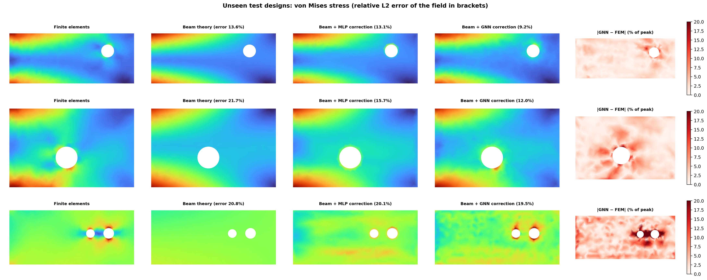
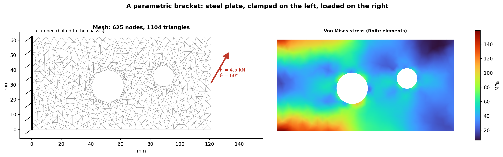
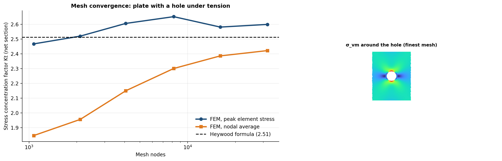
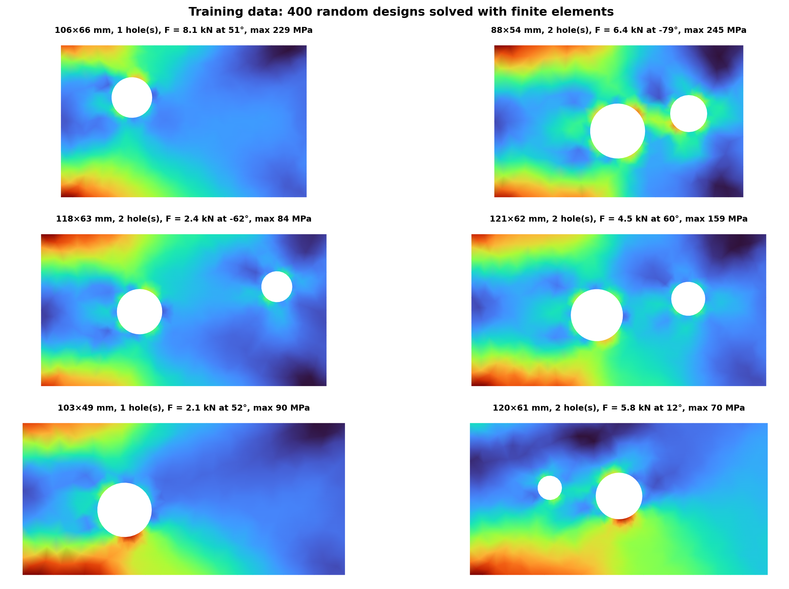
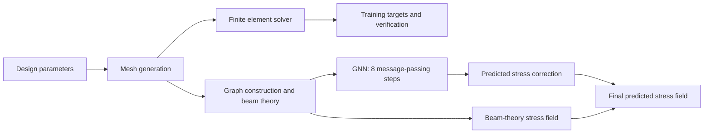
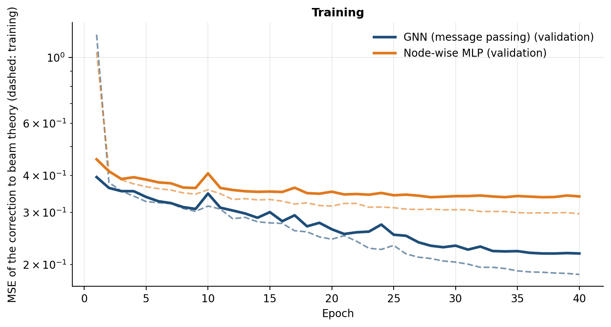
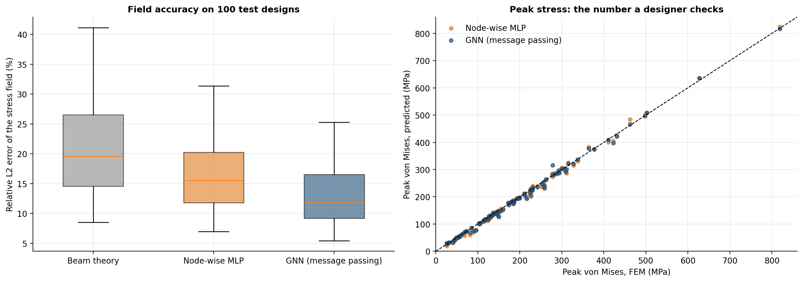
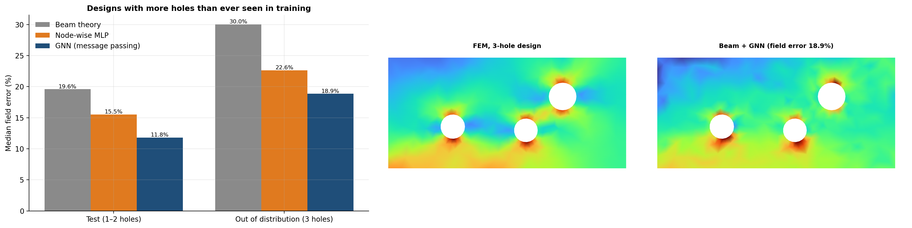
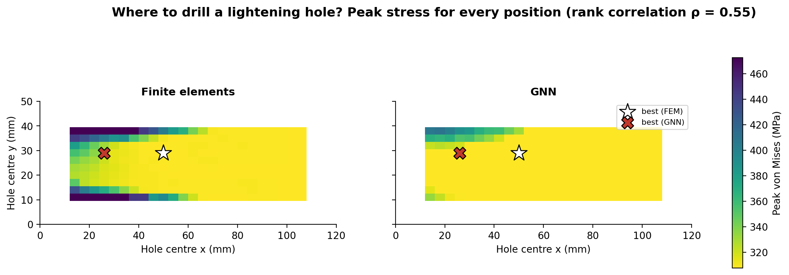
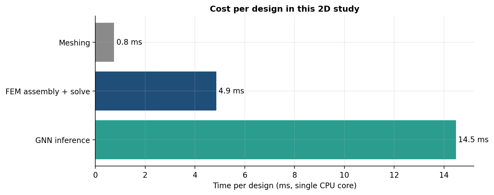

# Graph Neural Network Surrogate for Finite Element Analysis of an Automotive Bracket

**Finite element analysis · Mesh-based GNNs · Physics-informed residual learning · Structural mechanics · Design screening**

Finite element analysis (FEA) is an important part of automotive structural design, but evaluating every design variation can become computationally expensive. Surrogate models offer a way to estimate simulation results from previously evaluated designs. Graph neural networks (GNNs) are particularly suitable for mesh-based problems because finite element meshes naturally represent relationships between neighboring nodes.

This project implements a complete workflow in Python: a parametric bracket, a finite element solver developed from scratch and validated against analytical solutions, a dataset of 660 simulated designs, and a mesh-based GNN that predicts the von Mises stress field.

The final model combines classical beam theory with graph-based learning. Rather than predicting stress from scratch, the GNN learns a correction to the analytical baseline, accounting for effects that beam theory does not capture well, particularly around holes and the clamped boundary.



## Key Results

The table reports median errors across 100 test designs containing one or two holes and 100 out-of-distribution (OOD) designs containing three holes, a configuration not represented in training.

| Model | Field error — test | Peak error — test | Field error — 3 holes | Peak error — 3 holes |
|---|---:|---:|---:|---:|
| Beam theory | 19.6% | 5.2% | 30.0% | 6.9% |
| Beam theory + node-wise MLP | 15.5% | 2.5% | 22.6% | 4.8% |
| **Beam theory + GNN** | **11.8%** | **1.7%** | **18.9%** | **4.1%** |

*Field error is the relative L2 error of the nodal von Mises stress field. Peak error is the absolute relative error in the maximum von Mises stress.*

The main findings are:

- **Improved stress-field prediction:** The GNN correction reduces the median field error by approximately 40% relative to beam theory alone. Peak stress error decreases from 5.2% to 1.7%.
- **Benefits of message passing:** The GNN outperforms a node-wise MLP with the same general depth and width. Message passing allows the model to incorporate information from neighboring mesh nodes, helping it represent local geometric effects that cannot be inferred as easily from isolated node features.
- **Generalization to unseen geometry:** All models become less accurate on designs with three holes. The hybrid GNN retains the lowest median errors among the evaluated approaches.
- **Runtime depends on problem size:** For this small 2D problem, the finite element solve takes approximately 5 ms per design, while GNN inference takes approximately 14 ms on a CPU. The surrogate is therefore not faster in this setting. Its potential value lies in more expensive simulations, such as large 3D meshes, nonlinear material models, contact problems, transient analyses, or computational fluid dynamics.

The project uses a relatively small structural problem so that simulation data can be generated efficiently and the predictions can be compared against a reference solver.

## Problem Setup

The structure is a steel bracket attached to a chassis along its left edge and loaded along its right edge. Circular lightening holes can be introduced to reduce material usage.

The design space varies:

- **Length:** 80–140 mm.
- **Height:** 40–70 mm.
- **Hole geometry:** Number, size, and position.
- **Applied load:** 2–10 kN.
- **Load direction:** From pure tension to pure shear.

The bracket is modeled as a 5 mm-thick, linearly elastic steel structure under plane-stress assumptions.



## Finite Element Solver

The finite element solver is implemented from scratch in `src/fem.py`. It uses constant-strain triangular elements, sparse matrix assembly with SciPy, a clamped boundary condition, and distributed traction along the loaded edge.

Meshes are generated using Shewchuk's Triangle, with refinement around the circular holes to better resolve stress concentrations.

### Validation Against Analytical Results

The solver is validated using a plate with a central hole under tension. For a diameter-to-width ratio of \(d/W = 0.2\), the Heywood formula gives a stress concentration factor of approximately \(K_t = 2.51\).

With mesh refinement, the finite element results bracket this reference value:

- **Peak element stress:** \(K_t = 2.60\).
- **Nodal-averaged stress:** \(K_t = 2.42\).

Both estimates are within approximately 4% of the analytical value. Unit tests also check force equilibrium, uniform tension, and agreement with beam theory sufficiently far from the holes.





## Graph Neural Network Architecture

Each finite element mesh is represented as a graph. Mesh nodes become graph nodes, and element edges define the connections between them in both directions.

### Node and Edge Features

**Node features** are dimensionless and include:

- Node position.
- Distance to the free end and to the top and bottom edges.
- Boundary-condition indicators for free, clamped, and loaded nodes.
- Load direction.
- Bracket aspect ratio.
- Stress predicted by beam theory.

The network is not explicitly given the locations of the holes. Instead, it must infer their effects from the mesh geometry and the information exchanged between neighboring nodes.

**Edge features** include the relative position of the connected nodes and the edge length.

### Architecture and Learning Target

The model is implemented from scratch in TensorFlow, following the mesh-based message-passing approach introduced by MeshGraphNets (Pfaff et al., 2021).

Its main components are:

- **Encoder:** Maps node and edge features into hidden representations.
- **Message-passing processor:** Performs eight rounds of edge updates using information from both endpoint nodes, mean aggregation, and residual node updates.
- **Decoder:** Predicts a correction to the analytical stress estimate.
- **Hidden dimension:** 48 units.

The target is the difference between the finite element stress and the beam-theory prediction, normalized by the nominal stress \(F/(H \cdot t)\), where \(F\) is the applied force, \(H\) is the bracket height, and \(t\) is the thickness.

This normalization allows the model to learn a correction across different bracket sizes and loading magnitudes.





## Why the Hybrid Model Works Better

The first implementation attempted to predict stress directly from geometry and loading conditions.

When hand-crafted hole descriptors, such as distance to the nearest hole and hole radius, were included, the MLP performed similarly to the GNN. These descriptors supplied information about the holes explicitly, reducing the advantage of learning geometric relationships through message passing. They were also specific to circular-hole geometries.

Without these descriptors, the GNN achieved a field error of 16.3%, compared with 16.6% for the MLP. However, both models were less accurate than beam theory for peak stress prediction: errors were 6.2% and 5.9%, respectively, compared with 5.2% for the analytical baseline.

This behavior is consistent with the fact that peak stress often occurs near the clamped root, where bending dominates and beam theory already provides a useful approximation.

The hybrid approach addresses this limitation by learning only the residual between the finite element solution and beam theory. The analytical model provides the global stress estimate, while the GNN focuses on corrections associated with local geometry and boundary effects.

This reduces the burden on the neural network: it does not need to relearn structural relationships that are already described reasonably well by classical mechanics.

## Accuracy and Generalization

The following results compare the predicted stress fields with the finite element reference solution, including designs outside the training distribution.



*Comparison of prediction errors across the evaluated models.*



*Evaluation on designs with three holes, which were not included in training.*

The increased errors on three-hole designs show that the model's accuracy depends on the geometry represented in the training data. Although the hybrid GNN performs best among the evaluated approaches, the OOD results do not establish generalization to arbitrary bracket geometries.

## Design Screening: Where Should a Lightening Hole Be Placed?

The surrogate is also evaluated on a design-screening task.

For a bracket measuring 120 × 50 mm under a 6 kN load applied at −60°, a 14 mm hole is placed at 240 candidate positions. The maximum von Mises stress is then estimated using both the finite element solver and the GNN surrogate.

In most candidate positions, the maximum stress remains near the clamped root and changes little. Hole placement becomes more influential when the hole is close to the clamped boundary.

The GNN achieves a Spearman rank correlation of 0.55 with the finite element ranking. Its selected position produces a peak stress of 325 MPa, compared with 308 MPa at the best position identified by the finite element analysis. The worst candidate reaches 606 MPa.

These results suggest that the surrogate can help screen candidate designs, but its ranking is not sufficiently accurate to replace finite element verification.





## Project Structure

```text
├── config.py                  # Material properties, design space, dataset size, GNN settings
├── train.py                   # Dataset generation and training of the GNN and MLP baseline
├── evaluate.py                # Metrics, FEM validation, design screening, timing, and plots
├── src/
│   ├── geometry.py             # Parametric bracket geometry and meshing
│   ├── fem.py                  # Plane-stress finite element solver
│   ├── beam.py                 # Analytical beam-theory baseline
│   ├── simulate.py             # FE simulation and graph conversion
│   ├── dataset.py              # Dataset of 660 simulated designs
│   ├── gnn.py                  # Message-passing network, batching, and training
│   └── plots.py                # Visualization utilities
├── tests/
│   └── test_core.py             # Equilibrium, analytical validation, permutation equivariance
├── models/                      # Trained model weights
├── figures/
└── results/
```

## How to Run

### 1. Create a virtual environment

```bash
python -m venv .venv

.\.venv\Scripts\Activate.ps1

pip install -r requirements.txt
```

### 2. Train the models

```bash
python train.py
```

The script generates the dataset of 660 designs if needed and trains the GNN and MLP baseline. On the reference setup, dataset generation takes approximately 10 seconds, while training takes around 15 minutes on a single CPU core.

### 3. Run the evaluation

```bash
python evaluate.py
```

The evaluation takes approximately three minutes on the reference setup and generates the reported metrics and figures.

The trained weights are included in the repository, so evaluation can run without retraining. The dataset is regenerated automatically and deterministically when needed.

### 4. Run the tests

```bash
pytest
```

The tests cover force equilibrium, validation against analytical results, and permutation equivariance.

## Limitations and Next Steps

The current implementation is designed as a controlled study of mesh-based learning rather than a production-ready structural analysis tool.

- **Two-dimensional linear elasticity:** The problem uses small 2D meshes and linear elastic material behavior. Three-dimensional structures, nonlinear materials, contact, and transient loading are not covered.
- **Finite element discretization:** Constant-strain triangular elements can underestimate peak stresses on coarse meshes. Because the GNN learns from the solver's outputs, it also learns its discretization errors.
- **Limited message-passing range:** Eight message-passing steps allow information to travel only a limited number of mesh edges. Multiscale graphs or global information nodes could better capture long-range load paths.
- **Restricted design distribution:** The model is trained on a finite set of bracket geometries and load cases. Its performance on substantially different structures remains untested.
- **No guaranteed runtime advantage for small problems:** In the current 2D setting, GNN inference is slower than the finite element solve. The main motivation for a surrogate is to reduce the cost of more computationally demanding simulations.

Potential next steps include:

- Extending the method to 3D tetrahedral meshes.
- Implementing the architecture with PyTorch Geometric.
- Introducing multiscale message passing to capture longer-range mechanical interactions.
- Estimating predictive uncertainty so that uncertain designs can be sent back to the finite element solver.
- Coupling the surrogate with Bayesian optimization for automated design exploration.

## References

- T. Pfaff, M. Fortunato, A. Sanchez-Gonzalez, and P. W. Battaglia, “Learning Mesh-Based Simulation with Graph Networks,” *International Conference on Learning Representations (ICLR)*, 2021.
- P. W. Battaglia et al., “Relational inductive biases, deep learning, and graph networks,” *arXiv:1806.01261*, 2018.
- J. R. Shewchuk, “Triangle: Engineering a 2D Quality Mesh Generator and Delaunay Triangulator,” *Applied Computational Geometry*, 1996.
- W. D. Pilkey and D. F. Pilkey, *Peterson's Stress Concentration Factors*, 3rd ed., Wiley, 2008.

## Author

**Evelyn Natalie Aguiar de Almeida**

Mechanical Engineer · M.Sc. in Computer Science · Ph.D. Student in Computer Science